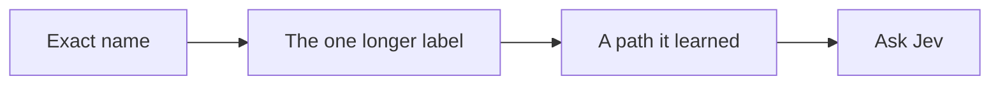

# windows-jev-mcp

A UI clicking tool for Windows.

An agent names a control. This server moves the pointer and presses it. Here it is on Calculator, clicking through 12 + 7:


The pointer lands on each key. The display ends at **19**. The clip is slowed down so the pointer is easy to follow. Those clicks were a few tens of milliseconds apart, and none of them asked a model, because the names were already on screen.

If a name is not on screen, [Jev](https://typesafe.ai) picks the control. A missing button is left alone. A click that would hit a different window is refused. Send, Delete, and Close are skipped while it is searching. A step has to name them.

## Paste this to install it

Give this to an agent. It installs the command and does not click anything.

```
Install windows-jev on this Windows machine with uv. Do not open or click any app.

- If uv is missing, install it with: powershell -ExecutionPolicy ByPass -c "irm https://astral.sh/uv/install.ps1 | iex"
- Run: uv tool install --force --reinstall git+https://github.com/dorianherle/windows-jev-mcp.git
- Open a new terminal if windows-jev is not found.
- windows-jev check must print "self-check ok".
- Run: windows-jev setup
- If that prints "key: already set", do not ask for a key.
- If that prints "key: missing", ask me for a TypeSafe API key, set the user environment variable TYPESAFE_API_KEY, and run windows-jev setup again. Never print the key and never commit it.
- windows-jev --help must list goal, describe, and run. Do not run those during install.
- If setup prints "mcp: none", tell me that a task is: windows-jev goal WINDOW the task. Do not take a screenshot.
- If setup prints "mcp:" with a name, tell me to reload that editor and allow windows-jev. In VS Code that is Copilot Chat, Agent mode. After the reload, a task is run_goal. Do not take a screenshot.
```

That is the whole install. Windows 10 or 11. A key from [typesafe.ai](https://typesafe.ai) is only used when a button name is not already on screen.

`windows-jev setup` registers the server for whichever editor is installed. When this chat has MCP, a task is `run_goal`: Jev picks the clicks. Copilot Chat in VS Code needs Agent mode. Cursor uses the same tool.

## Paste this to update it

Give this to an agent when windows-jev is already installed. It replaces the tool and does not click anything.

```
Update windows-jev on this Windows machine. Do not open or click any app.

- Run: uv tool install --force --reinstall git+https://github.com/dorianherle/windows-jev-mcp.git
- A reinstall replaces the tool environment. If a window has no control names, install the vision extra again or MCP fails with "No module named numpy". Run:
  uv pip install --python "$(uv tool dir)\windows-jev-mcp\Scripts\python.exe" --index-url https://download.pytorch.org/whl/cpu --extra-index-url https://pypi.org/simple numpy torch torchvision "openvino>=2025.0" huggingface_hub "winocr>=0.0.15"
- windows-jev check must print "self-check ok".
- Reload the editor so it restarts windows-jev. Do not take a screenshot.
```

## Paste this to use it

Replace the first line with the task. Leave the instructions under it.

```
<task>

Hand the task above to Jev. Jev decides what to click. Touch only the app the task names. Do not take a screenshot, and do not open any image.

- If this chat can call the windows-jev tools, call run_goal with the window and this task. Do not call describe to plan the clicks.
- If the result says needs_text, call provide_text with the text the task asked for.
- If it cannot call tools, run: windows-jev goal WINDOW the task
- Do not click Send, Delete, or Close unless the task names them.
- Do not use a screenshot tool, a screen capture, or the files under ~/windows_jev_runs. If you are unsure what is on screen, call run_goal again.
- Stop when the status is done or stopped.
```

`run_goal` is Jev choosing each click from the control names on screen. It returns those actions as text. For the clip above, the task line is `On Calculator, compute 12 + 7`.

When the control names are already known, they can be clicked without asking Jev:

```text
windows-jev describe Calculator
windows-jev run Calculator One Two Plus Seven Equals
```

| | |
|---|---|
| **total** | How many checks you defined |
| **time** | `total_ms` |
| **log** | `status` and the steps |
| **score** | How many checks showed up |

Jev reads control names. The tool result has no picture and no folder path. A log is kept in `~/windows_jev_runs` for a person to open later.

A step can also type: `type "https://example.com" into Address and press enter`. The later steps in that same list already see the new page.

Windows Calculator calls the keys `One` and `Plus`, not `1` and `+`. Use the names from `describe`.

## What it tries, in order



A path that worked once is saved in `~/windows_jev_library` and skipped past Jev next time.

| In the terminal | In an editor with MCP |
|---|---|
| `windows-jev goal Calculator "compute 12 + 7"` | `run_goal` |
| `windows-jev windows` | `list_windows` |
| `windows-jev describe Calculator` | `describe` |
| `windows-jev run Calculator One Two Plus Seven Equals` | `run_steps` |
| | `provide_text` |

That order under the diagram is only for `run`, when the names are already known. `goal` asks Jev on every click.

A click under another window is refused. No pixel change within 600 ms means it missed. Jev reads text, up to 250 controls. Apps with no names need the optional vision extra in `requirements-vision.txt`.
