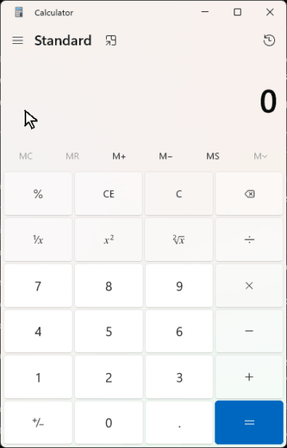
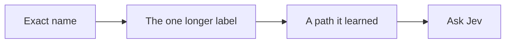

# windows-jev-mcp

A UI clicking tool for Windows.

An agent names a control. This server moves the pointer and presses it. Here it is on Calculator, clicking through 12 + 7:



The pointer lands on each key. The display ends at **19**. The clip is slowed down so the pointer is easy to follow. Those clicks were a few tens of milliseconds apart, and none of them asked a model, because the names were already on screen.

If a name is not on screen, [Jev](https://typesafe.ai) picks the control. A missing button is left alone. A click that would hit a different window is refused. Send, Delete, and Close are skipped while it is searching. A step has to name them.

## Paste this to install it

Give this to an agent. It installs the command and does not click anything.

```
Install windows-jev on this Windows machine with uv. Do not open or click any app.

- If uv is missing, install it with: powershell -ExecutionPolicy ByPass -c "irm https://astral.sh/uv/install.ps1 | iex"
- Run: uv tool install git+https://github.com/dorianherle/windows-jev-mcp.git
- Open a new terminal if windows-jev is not found.
- windows-jev check must print "self-check ok".
- Run: windows-jev setup
- If that prints "key: already set", do not ask for a key.
- If that prints "key: missing", ask me for a TypeSafe API key, set the user environment variable TYPESAFE_API_KEY, and run windows-jev setup again. Never print the key and never commit it.
- If that prints "mcp: none", there is no MCP editor. Use the terminal: windows-jev describe and windows-jev run.
- If that prints "mcp:" with a name, and this chat can call tools, use the windows-jev tools (describe, run_steps). Tell me to reload that editor and allow windows-jev. In VS Code that is Copilot Chat, Agent mode.
- If this chat cannot call tools, use the terminal even when an editor is listed.
```

That is the whole install. Windows 10 or 11. A key from [typesafe.ai](https://typesafe.ai) is only used when a button name is not already on screen.

`windows-jev setup` registers the server for whichever editor is installed. When this chat has MCP, call `describe` and `run_steps`. Copilot Chat in VS Code needs Agent mode. Cursor uses the same tools.

Without MCP, the terminal is the whole interface. Calculator has to be open:

```text
windows-jev describe Calculator
windows-jev run Calculator One Two Plus Seven Equals
```

`describe` only looks. `run` moves the pointer. The result should say `Display is 19`. An editor with MCP calls the same thing as `describe` and `run_steps`.

| | |
|---|---|
| **total** | How many checks you defined |
| **time** | `total_ms` |
| **log** | `status`, the steps, and the screenshot folder |
| **score** | How many checks showed up |

Screenshots land in `~/windows_jev_runs`.

A step can also type: `type "https://example.com" into Address and press enter`. The later steps in that same list already see the new page.

Windows Calculator calls the keys `One` and `Plus`, not `1` and `+`. Use the names from `describe`.

## What it tries, in order



A path that worked once is saved in `~/windows_jev_library` and skipped past Jev next time.

| In the terminal | In an editor with MCP |
|---|---|
| `windows-jev windows` | `list_windows` |
| `windows-jev describe Calculator` | `describe` |
| `windows-jev run Calculator One Two Plus Seven Equals` | `run_steps` |
| | `run_goal`, `provide_text`, `show_graph` |

A click under another window is refused. No pixel change within 600 ms means it missed. Jev reads text, up to 250 controls. Apps with no names need the optional vision extra in `requirements-vision.txt`.
