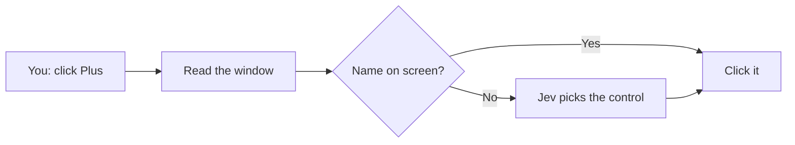
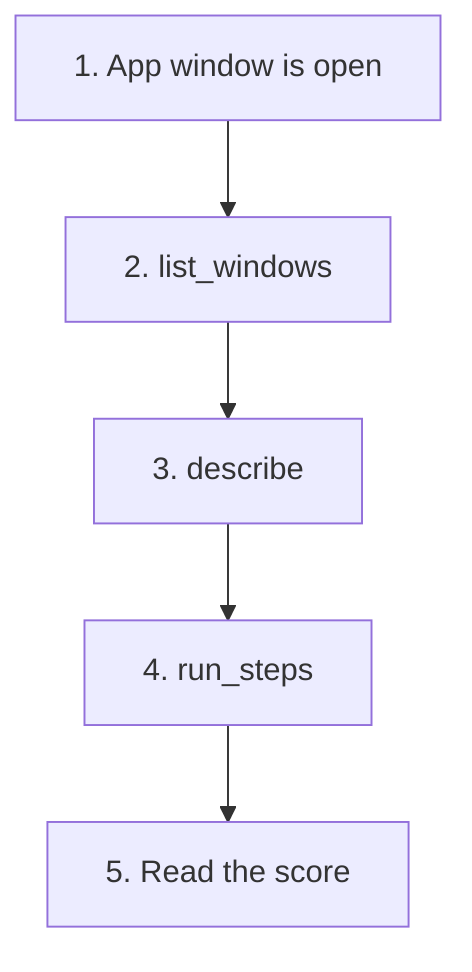
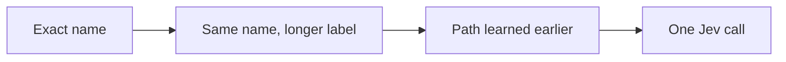

# windows-jev-mcp

An MCP server that **clicks and types in Windows apps** for you.

You name the buttons. It finds them on the real window and presses them. If the name is already on screen, it does not call a model. [Jev](https://typesafe.ai) is only asked when the control is not obvious.



It refuses a click that would land on a different window. While it is searching, it will not press Send, Delete, or Close. Name those steps yourself only when you mean them.

## Test an app

The app has to be open. Then four calls:



`describe` only looks. `run_steps` does the clicks.

```text
list_windows()
describe("Calculator")
run_steps("Calculator", ["1", "Plus", "1", "Equals"])
```

A pass is: the result text contains `2`.

| | What to report |
|---|---|
| **total** | How many things you checked |
| **time** | `total_ms` from the result |
| **log** | `status`, each step, and the screenshot folder |
| **score** | How many checks are true |

Screenshots are saved under `~/windows_jev_runs`. `stepN_screen.png` is the window just before that click.

Typing works the same way. One step can be:

```text
type "https://example.com" into Address and press enter
```

The steps after Enter already see the new page. Keep them in the same `run_steps` list.

If `status` starts with `stopped:`, that one name was not on screen. Call `describe` again and fix that step. If `screen_changed` is false, the click did not land.

## Install

Windows 10 or 11, Python 3.11 or newer.

```powershell
git clone https://github.com/dorianherle/windows-jev-mcp.git
cd windows-jev-mcp
python -m pip install -r requirements.txt
python win_agent.py --check
```

You want the line `self-check ok`. That check does not open a window.

A TypeSafe key is needed only when a button name is not already visible. Put it in `.env` next to `win_agent.py` (this file is never committed):

```
TYPESAFE_API_KEY=your-key-here
```

Get a key at [typesafe.ai](https://typesafe.ai).

In Cursor, add this to `~/.cursor/mcp.json`, then restart the MCP server:

```json
{
  "mcpServers": {
    "windows-jev": {
      "command": "C:\\path\\to\\python.exe",
      "args": ["C:\\path\\to\\windows-jev-mcp\\windows_jev_mcp.py"]
    }
  }
}
```

The key can live in that file under `env` instead of `.env`.

## Prompt to give an agent

```
Set up https://github.com/dorianherle/windows-jev-mcp and test a Windows app by clicking its real UI.

Install
- Windows 10/11 and Python 3.11+.
- Clone the repo, pip install -r requirements.txt, run python win_agent.py --check.
- Stop if it does not print "self-check ok".
- If .env is missing, ask me for a TypeSafe key. Write only TYPESAFE_API_KEY=... into a gitignored .env next to win_agent.py. Never commit it and never print it.
- Register windows_jev_mcp.py as an MCP server named windows-jev, then restart that server.

Test
1. Use a window that is already open, or launch the app. Pick the title from list_windows.
2. describe(window) does not click. Read buttons, fields, and screen_text before you plan.
3. run_steps(window, steps) once. A step is a control name ("Seven") or: type "the text" into Field name and press enter.
4. Do not click Send, Delete, pay, submit, or close unless I asked for that step.
5. Show me total, time (total_ms), log (status, steps, screenshot folder), and score.
6. If status starts with "stopped:", describe again and replace that one step.
7. If screen_changed is false, the click missed. Say so.

Calculator example: window "Calculator", steps ["1", "Plus", "1", "Equals"]. Pass when the result contains "2".
```

## How a step is chosen



Jev may answer "none". A weak guess is dropped, so a missing button is not clicked at random. A path that worked once is remembered in `~/windows_jev_library` and reused with no model call.

## Tools

| Tool | Use it for |
|---|---|
| `list_windows()` | See window titles |
| `describe(window)` | Read buttons and fields. No clicks |
| `run_steps(window, steps)` | Run the test. Start here |
| `run_goal(window, goal)` | Let Jev choose every click. Slower |
| `provide_text(text)` | Answer `run_goal` when it asks what to type |
| `explore(window)` | Click tabs only, to learn the app |
| `show_graph(app)` | Open the learned paths as a page |
| `edit_graph(...)` | Correct a learned path |

## Limits

- A button hidden under another window is not clicked.
- No pixel change within 600 ms means the click missed.
- Jev reads text, up to 250 controls. Bare icons need the optional vision extra in `requirements-vision.txt` ([OmniParser](https://github.com/microsoft/OmniParser), AGPL weights).
