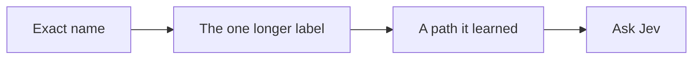

# windows-jev-mcp

A UI clicking tool for Windows.

An agent names a control. This server moves the pointer and presses it. Here it is on Calculator, clicking through 12 + 7:


The pointer lands on each key. The display ends at **19**. The clip is slowed down so the pointer is easy to follow. Those clicks were a few tens of milliseconds apart, and none of them asked a model, because the names were already on screen.

If a name is not on screen, [Jev](https://typesafe.ai) picks the control. A missing button is left alone. A click that would hit a different window is refused. Send, Delete, and Close are skipped while it is searching. A step has to name them.

## Paste this to install it

Give this to an agent. It sets the server up and does not touch any app.

```
Install windows-jev-mcp on this machine and stop when it is ready. Do not open or click any app.

- Clone https://github.com/dorianherle/windows-jev-mcp.git
- Use Python 3.11 or newer. Run pip install -r requirements.txt
- Run python win_agent.py --check. It must print "self-check ok".
- Ask me for a TypeSafe API key. Write it only as TYPESAFE_API_KEY=... in a .env file next to win_agent.py. That file is gitignored. Never commit the key and never print it.
- Register an MCP server named windows-jev that launches windows_jev_mcp.py with this Python. In Cursor, that goes in ~/.cursor/mcp.json.
- Tell me to restart the MCP server, then stop.
```

Windows 10 or 11. A key from [typesafe.ai](https://typesafe.ai) is only used when a button name is not already visible.

The Cursor config looks like this:

```json
{
  "mcpServers": {
    "windows-jev": {
      "command": "C:\\path\\to\\python.exe",
      "args": ["C:\\path\\to\\windows-jev-mcp\\windows_jev_mcp.py"]
    }
  }
}
```

## The same clicks, as a call

Calculator has to be open. The agent then calls:

```text
describe("Calculator")
run_steps("Calculator", ["One", "Two", "Plus", "Seven", "Equals"])
```

`describe` only looks. `run_steps` moves the pointer through the list. The result should say `Display is 19`.

| | |
|---|---|
| **total** | How many checks you defined |
| **time** | `total_ms` |
| **log** | `status`, the steps, and the screenshot folder |
| **score** | How many checks showed up |

Screenshots land in `~/windows_jev_runs`.

A step can also type: `type "https://example.com" into Address and press enter`. The later steps in that same list already see the new page.

Windows Calculator calls the keys `One` and `Plus`, not `1` and `+`. Use the names from `describe`.

## What it tries, in order



A path that worked once is saved in `~/windows_jev_library` and skipped past Jev next time.

| Tool | For |
|---|---|
| `list_windows()` | Window titles |
| `describe(window)` | Buttons and fields, no clicks |
| `run_steps(window, steps)` | The test |
| `run_goal(window, goal)` | Let Jev pick every click. Slower |
| `provide_text(text)` | Answer when `run_goal` asks what to type |
| `show_graph(app)` | The learned paths, as a page |

A click under another window is refused. No pixel change within 600 ms means it missed. Jev reads text, up to 250 controls. Apps with no names need the optional vision extra in `requirements-vision.txt`.
